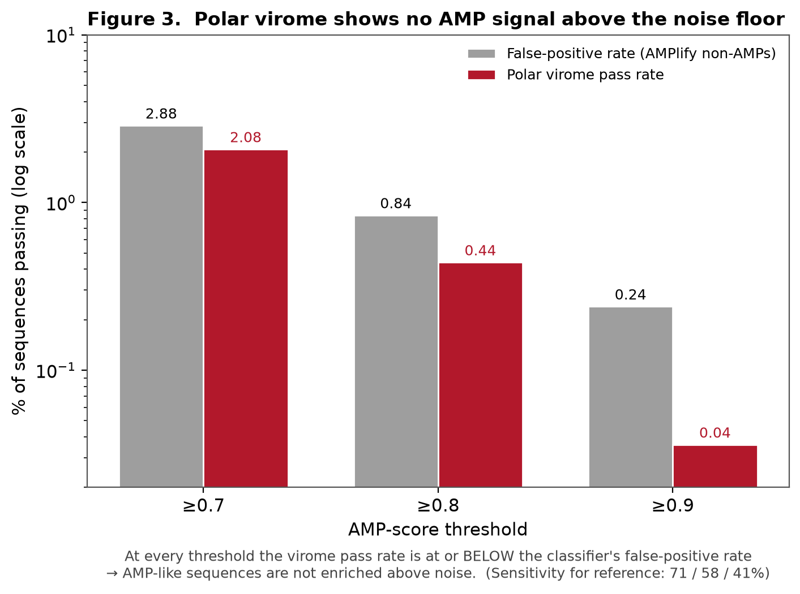
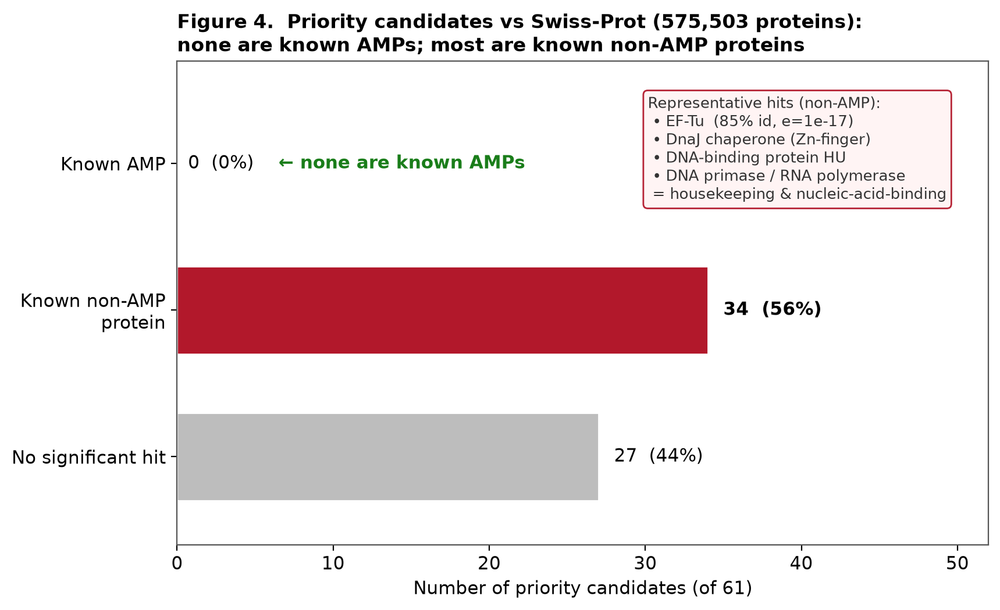
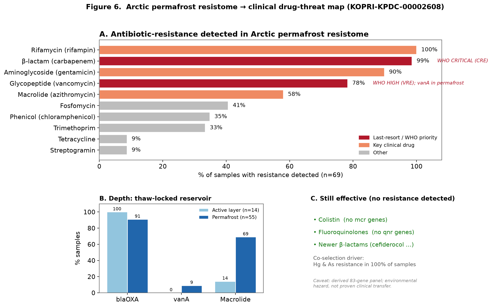

# Polar Permafrost Antimicrobial Peptide Discovery — and a Rigorous Reality-Check

*2026 Korea Polar Data Center — Polar Big Data & AI Competition, Data Analysis Track*

**Authors:** Jungho Sohn · Hyunjin Cho

---

## TL;DR
Antibiotic resistance is a growing threat, and AI-driven mining of metagenomes is widely promoted as a way to discover new antimicrobial peptides (AMPs) from "untapped" sources such as polar microbiomes. **This project builds that pipeline for the Arctic permafrost virome — and then rigorously stress-tests its own results.**

The verdict: the polar virome shows **no AMP signal above the classifier's noise floor**, and the top candidates turn out to be **known non-AMP proteins**, not novel antimicrobials. So instead of over-claiming a discovery, this work delivers:

1. a **reproducible ML pipeline** for AMP screening,
2. a **6-part validation framework** that exposes the failure modes naive AI antimicrobial-discovery pipelines routinely miss, and
3. a pharmacist-oriented **antibiotic drug-threat map** of the permafrost resistome.

> The point of the project is not the excitement of discovery, but the discipline of validation.

---

## Key findings

| # | Test | Result |
|---|---|---|
| 1 | **False-positive base rate** | Virome pass-rate ≤ classifier's false-positive rate at every threshold → no enrichment above noise |
| 2 | **Functional annotation** (vs Swiss-Prot 575k) | **0 / 61** priority candidates match a known AMP; most match known non-AMP proteins (EF-Tu, DnaJ, HU) |
| 3 | **Standardized novelty** | "Novel" collapses from 100% (vs DRAMP) to **48%** when compared against AMPSphere (863k) |
| 4 | **Counterfactual** | The "cysteine-rich chemical space" is a **filter artifact**, not a polar-specific signal |
| 5 | **Selectivity** | Activity and toxicity both track hydrophobicity → the low-toxicity filter discards the most active candidates |
| 6 | **Order control** | Shuffling residues leaves scores unchanged (Δ = 0.000000) → the model reads composition, not sequence |

**Drug-threat map (resistome):** the Arctic permafrost harbors widespread resistance to last-resort drugs — carbapenems (β-lactam 99%), vancomycin (78%), rifampin (100%) — while colistin and fluoroquinolones remain unchallenged.

### Figures




*(All figures in [`figures/`](figures/).)*

---

## Repository structure
```
├─ report/           Analysis report (REPORT.md, English)
├─ figures/          Figures (ROC, FPR, functional annotation, novelty, drug-threat map)
├─ code/
│   ├─ 01_discovery_pipeline/   AMP classifier + virome screening (Colab-scale run)
│   └─ 02_validation/           Validation (FPR, annotation, novelty, selectivity) + drug-mapping + independent_reproduction.py
├─ results/          Result tables (model comparison, candidates, drug mapping)
├─ AI_USAGE.md       Generative-AI / pretrained-model / tool usage & licenses
└─ LICENSE
```

## Reproducibility
- Python 3.13, fixed seed 42. Reference datasets (AMPlify, HemoPI, DRAMP, AMPSphere, Swiss-Prot) are auto-downloaded by the scripts.
- **[`code/02_validation/independent_reproduction.py`](code/02_validation/independent_reproduction.py)** independently recomputes the headline numbers **from raw data only, without reading any result files** — and they match the report. This is the self-contained reproducibility check.
- The heavy full screen (127,005 contigs, pyrodigal) runs on Google Colab via `colab_full_run.py`. A few scripts consume intermediates it produces (e.g. `virome_candidates_ALL.csv`, MMseqs `.m8` hit tables) rather than committed outputs.

### Supporting analyses (cross-referenced in the report)
- **[`code/01_discovery_pipeline/esm2_benchmark.py`](code/01_discovery_pipeline/esm2_benchmark.py)** — ESM-2 (`esm2_t30_150M`) embedding benchmark vs. the 27-feature model (§4.1). Needs a GPU + `fair-esm` (Colab).
- **[`code/01_discovery_pipeline/p6_enrichment.py`](code/01_discovery_pipeline/p6_enrichment.py)** — cross-environment enrichment, permafrost virome vs. human-gut phage (§4.3.2). Needs a GPD comparison FASTA.
- **[`code/02_validation/c1_resistome_classification.py`](code/02_validation/c1_resistome_classification.py)** — shows the active-layer/permafrost split is largely explained by total resistance load (§4.4; runs on the raw ARG table).

## Data & sources
- **Primary (KPDC):** Arctic permafrost virome — `KOPRI-KPDC-00002605`; antibiotic-resistance genes — `KOPRI-KPDC-00002608`.
- **Raw KPDC data is not included** in this repository (subject to the Korea Polar Data Center's terms of use).
- **External:** AMPlify (BC Cancer GSC), HemoPI-2/3 (Raghava lab), DRAMP 3.0, AMPSphere (Santos-Júnior et al., *Cell* 2024), UniProt/Swiss-Prot, ESM-2 (Meta AI).

## Methods (one line)
Physicochemical features → RandomForest AMP classifier (beats a length+charge baseline; ROC in `figures/fig2`) → ORF screening → MMseqs2-based novelty & functional annotation → HemoPI toxicity → six-fold critical validation → resistome-to-drug mapping.

---

*License: MIT (code & docs only; see `LICENSE`). This project was created for the 2026 Polar Big Data & AI Competition.*
