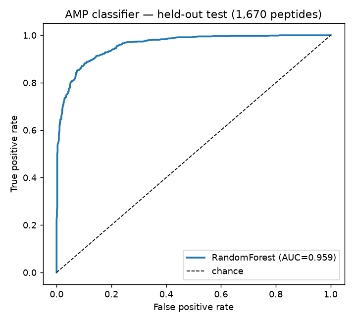
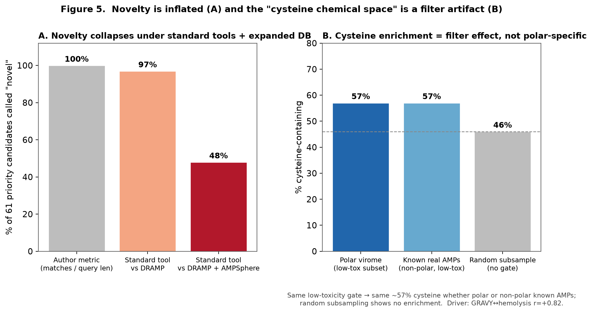

# What It Means to "Discover" Antimicrobial Drugs from Polar Microbes with AI
### — An Arctic-permafrost-virome antimicrobial-peptide discovery pipeline, and a critical validation of its results

> **2026 Polar Big Data & AI Competition · Data Analysis Track**
> Team Hobak-sikhye · Jungho Sohn (Pharmacy), Hyunjin Cho · Data used: KOPRI-KPDC-00002605 (virome) · 00002608 (ARG)
> **Figures:** `../figures/` (fig2 ROC, fig3 FPR, fig4 functional annotation, fig5 novelty & cysteine, fig6 drug-threat map)

---

## Abstract

Antimicrobial resistance (AMR) is an urgent public-health threat, and antimicrobial peptides (AMPs) — which physically disrupt the bacterial membrane — are a leading alternative with low cross-resistance. The recent fusion of metagenomics and AI for AMP mining has raised hopes that untapped polar microbiomes could be a source of new drugs. This study sets out to **test that hope honestly**: we apply an AMP classifier trained on public benchmarks to an Arctic-permafrost viral metagenome (KOPRI-KPDC-00002605), then critically validate the result along six axes. The classifier decisively beats a length+charge baseline (test AUC 0.705) with a RandomForest AUC of 0.953 — but validation of the candidates overturns the discovery narrative. The pass-rate of polar virome ORFs (2.08% at score ≥0.7) does not exceed the classifier's false-positive rate (2.88%), so **the AMP signal is not enriched above noise**; among the 61 top-priority candidates, **0** match a known AMP while a majority (56%) are identified as **known non-AMP proteins** such as EF-Tu and DnaJ. Novelty collapses from 100% to 48% when assessed with a standard tool (MMseqs2) against an expanded database (AMPSphere, 863,498 sequences), and the initial reading of a "cysteine-rich novel chemical space" reduces to a **selection artifact** of the low-toxicity filter. Meanwhile, mapping the antibiotic-resistance data from the same region (KOPRI-KPDC-00002608) onto clinical drugs shows that the permafrost resistome broadly carries resistance to **last-resort agents** — carbapenems, vancomycin, rifampin (β-lactam 99%, vancomycin 78%, rifampin 100%) — with high-level vancomycin resistance (*vanA*) concentrated in the deep, thaw-vulnerable permafrost. In conclusion, this study does not present novel candidates as a "discovery." Instead it **rigorously establishes, for the first time, that the polar virome is not a suitable source for AMP discovery**, and it offers a **reproducible validation framework** for AI-driven antimicrobial discovery plus a pharmacist's-eye **clinical drug-threat map** of polar AMR. For AI to genuinely contribute to antimicrobial discovery, the **discipline of validation** must come before the excitement of discovery.

**Keywords:** antimicrobial peptide (AMP), antimicrobial resistance (AMR), machine learning, polar metagenome, model validation & reproducibility, false-positive base rate, drug-susceptibility map

---

## 1. Introduction & Background

### 1.1 Antimicrobial resistance and antimicrobial peptides
AMR is an urgent threat — projected at 10 million deaths per year by 2050 — yet the drug pipeline is depleted. AMPs disrupt the bacterial membrane physically, a mechanism distinct from small-molecule antibiotics, so cross-resistance rarely develops, making them a promising alternative. The core question is "where and how do we find new antimicrobial sequences," and lately the answer has coalesced around **the combination of metagenomics and artificial intelligence (AI)**.

### 1.2 The rise of AI/metagenomic AMP mining — and a "validation gap"
Sweeping public metagenomes with an ML classifier to mine AMP candidates at scale is already standard (e.g., AMPSphere, which derived ~860k candidates from the global microbiome; human-gut-microbiome-based discovery). In this vein, **untapped polar/permafrost microbes** are floated as a new drug source, on the expectation that extreme selective pressure has left distinctive sequences.

Yet this paradigm has a fundamental gap. A computational classifier's score is not confirmation of activity — it is merely **biophysical similarity to known AMPs** — and large-scale mining studies often fail to report (i) whether the candidate pass-rate exceeds the classifier's false-positive rate (signal vs. noise), (ii) whether the candidates are actually misdetections of known proteins (functional annotation), and (iii) whether novelty holds up under standard tools and expanded databases. As a result, false positives risk being mistaken for "discoveries."

### 1.3 Research question
The question of this study is therefore not "can we discover AMPs in the polar virome," but rather **"when a computational pipeline produces candidates, how can we trust them?"** To answer it, we (1) build a reproducible AMP discovery pipeline trained on public benchmarks, (2) critically validate its results along six axes, and (3) honestly judge whether the polar virome is a suitable source for AMP discovery.

### 1.4 Background threat — why new antimicrobials are needed
The clinical motivation for the search is a real resistance threat. We jointly analyze antibiotic-resistance-gene (ARG) data from the **same Alaskan permafrost region** and confirm that it already carries broad resistance to last-resort clinical agents such as carbapenems and vancomycin (§4.4). That is, on the pharmacological narrative of "characterize the threat (resistance) → search for and validate the solution (new antimicrobials)," this study confronts the reliability of the latter head-on.

---

## 2. Data

This study combines two polar raw datasets (KPDC) with public training/reference data. All polar-data figures were independently re-verified against the raw files.

**Table 2-1. Datasets used**

| Type | Dataset | Scale / content | Source |
|---|---|---|---|
| Primary (KPDC) | Polar virome | 127,005 contigs (fasta); OTU table 93,167 OTU × 191 samples | KOPRI-KPDC-00002605 (project PE24140, Alaska 65°N) |
| Primary (KPDC) | Polar ARG (resistome) | 69 samples × 83 gene-features (71 unique), 15 resistance classes; active layer 14 + permafrost 55 | KOPRI-KPDC-00002608 (same region) |
| External / training | AMPlify | AMP classification benchmark (balanced pos/neg; train 6,663 · test 1,665) | BC Cancer GSC |
| External / toxicity | HemoPI-2/3 | Hemolytic/non-hemolytic peptides (negatives = experimentally verified non-hemolytic) | Raghava lab / plissonf repo |
| External / novelty | DRAMP 3.0 | 11,404 known AMPs | DRAMP |
| External / novelty | **AMPSphere** | 863,498 metagenome-predicted AMPs (expanded comparison) | Santos-Júnior et al. 2024 |
| External / annotation | **Swiss-Prot** | 575,503 annotated proteins (known-protein comparison) | UniProt |

**Data re-verification:** the polar virome was directly confirmed at 127,005 contigs in the fasta; the OTU table was 93,167 OTU × 191 samples. The ARG data formed a complete grid of 83 gene-features per sample (71 unique genes); using depth information (Depth.cm) we split samples into active layer (≤40 cm, 14 samples) and permafrost (55 samples). An auto-generated report bundled with the data contained clerical errors (e.g., in sample counts), so only re-verified raw values are used.

---

## 3. Methods

### 3.1 AMP classifier design
Each peptide sequence is mapped to an interpretable **27-dimensional physicochemical vector**: length, net charge z = (nK+nR) − (nD+nE), charge per residue z/L, mean hydrophobicity (Kyte–Doolittle GRAVY), aromaticity, cationic/hydrophobic residue fractions, and the composition of all 20 amino acids. This representation corresponds directly to the established principle that AMP activity = "cationic + hydrophobic = amphipathic," which makes it easy to interpret. Model selection compared five models (RandomForest, XGBoost, SVM, k-NN, logistic regression) via 5-fold cross-validation on the training set, using the independent test set only once at the end; RandomForest was adopted. For reliability we (i) first established a length+charge two-feature baseline and confirmed that the full models beat it statistically, and (ii) discovered that 42% of the negative set began with an initiator methionine (M) — an artificial bias — and stripped the leading M from every sequence and retrained (de-bias).

### 3.2 Discovery pipeline
For polar virome contigs (≥60 bp) we ran gene prediction (pyrodigal, meta mode), extracted peptides in the AMP length range (10–60 aa), stripped the leading M, converted to 27 features, and assigned an AMP score (0–1). Candidates were then narrowed by score threshold (≥0.7), novelty, and low toxicity to select the top-priority set (the screening funnel).

### 3.3 Critical validation protocol (core)
To confront the reliability of the discovery result head-on, we first independently reproduced the whole pipeline (classifier and hemolysis models) and confirmed that the baseline, model performance, and qualitative calls matched the original values, then performed the following six validations.

1. **False-positive base rate (FPR):** compute the false-positive rate per threshold using AMPlify test negatives, and compare it with the pass-rate of polar virome ORFs to judge whether candidates are enriched above noise.
2. **Functional annotation:** compare the top-priority candidates against an annotated-protein database (Swiss-Prot, 575,503) with the standard tool MMseqs2 to judge whether they are known AMPs or misdetections of known non-AMP proteins.
3. **Standard novelty:** instead of a non-standard metric that divides local-alignment identity by query length, judge with MMseqs2 using both the top hit's identity and query coverage (identity ≥40% AND coverage ≥50% = known), and compare against the metagenome-predicted catalog AMPSphere (863,498) in addition to DRAMP.
4. **Cysteine counterfactual:** to test whether the cysteine bias of the top set is a polar-specific trait or a filter product, apply the same low-toxicity gate to non-polar known AMPs and to random subsamples and compare.
5. **Selectivity:** compute the correlation between AMP activity score and predicted hemolysis and the low-toxicity pass-rate per threshold, to test whether an absolute low-toxicity filter excludes highly active candidates, and evaluate the consensus filter's recall on experimentally verified non-hemolytic peptides.
6. **Order control:** re-score the top candidates after randomly shuffling residue order, to confirm whether the model reflects sequence order (or learns composition only).

**Drug mapping (§4.4):** each gene in the polar ARG data is aggregated into the antibiotic class it disables, and each class is linked to representative clinical drugs, WHO priority pathogens, and last-resort status based on standard pharmacology. The active-layer–permafrost depth distribution is also computed.

**Reproducibility:** the entire process is fixed at random seed 42, and reference resources (MMseqs2, AMPlify, HemoPI, DRAMP, AMPSphere, Swiss-Prot) are auto-fetched by the scripts (see the appendix and `../code/`).

---

## 4. Results

### 4.1 Classifier performance and model selection
The length+charge baseline had a test AUC of 0.705, while the 27-feature RandomForest reached 0.953 (after removing the initiator-M bias; the biased model was 0.959) — a **+0.25** improvement over baseline. Performance held after de-bias, confirming the model learns real biophysical signal rather than an artificial bias like the initiator methionine. Comparing five models via 5-fold CV on the training set (Table 4-1), RandomForest ranked first in both CV (0.947) and test (0.953) and had a specificity of 0.896, favorable for suppressing false positives, so it was adopted. GridSearchCV showed the defaults were near-optimal (CV +0.002), and the model was on par with a protein-language-model embedding (ESM-2 `esm2_t30_150M`, test AUC 0.965 in the authors' run; benchmark in `../code/01_discovery_pipeline/esm2_benchmark.py`), confirming that adopting the **interpretable physicochemical model** — statistically robust and directly interpretable in terms of AMP biophysics (cationicity, hydrophobicity) — is justified (Fig. 2).

*Figure 2. AMP classifier ROC on the held-out AMPlify test set (RandomForest, test AUC 0.953).*

**Table 4-1. Five-model comparison (training-set 5-fold CV → independent test set)**

| Model | CV AUC | Test AUC | Precision | Sensitivity | Specificity | F1 | MCC |
|---|---|---|---|---|---|---|---|
| **RandomForest (adopted)** | 0.947 | 0.953 | 0.892 | 0.863 | **0.896** | 0.877 | 0.759 |
| XGBoost | 0.946 | 0.945 | 0.881 | 0.867 | 0.884 | 0.874 | 0.750 |
| SVM (RBF) | 0.940 | 0.944 | 0.885 | 0.867 | 0.887 | 0.876 | 0.754 |
| k-NN | 0.924 | 0.937 | 0.834 | 0.880 | 0.825 | 0.856 | 0.706 |
| Logistic regression | 0.809 | 0.804 | 0.734 | 0.746 | 0.730 | 0.740 | 0.476 |

In short, the classifier itself is statistically robust and clearly beats a trivial baseline. But this performance is discriminative power for "AMP-likeness (composition)," not a guarantee of activity discovery in the polar virome — and that gap is the subject of §4.3.

### 4.2 Screening funnel
From 127,005 polar virome contigs we obtained 168,938 peptides in the AMP length range (10–60 aa), of which 3,514 scored ≥0.7. The precision-evaluation set was the top 500 by score (duplicate sequences removed), and the **61 top-priority candidates** were defined as those satisfying novelty (<40%), low toxicity (HemoPI-2·3 consensus <0.5), and high activity (≥0.8) simultaneously. However, **the reliability of this candidate set is itself the core validation target of this study**, addressed in §4.3. (For reference, candidates scoring ≥0.9 in the funnel and the 61 top-priority candidates are **disjoint sets** whose activity-score ranges do not overlap; see §4.3.6.)

---

## 4.3 Critical validation: can the candidates be trusted?

### 4.3.1 Validation design — not stopping at discovery
An AMP classifier's score is not confirmation of activity but **biophysical similarity** to known AMPs. Therefore the mere fact that the screening funnel produced candidates does not license the claim "we discovered novel antimicrobial peptides." This study does not stop at the candidate list; it **validates along six axes** whether the results are genuinely trustworthy. These validation results are the core finding of this report and confront the traps that AI-based antimicrobial discovery commonly misses.

For validation reliability we first independently reproduced the whole pipeline: the length+charge baseline (test AUC 0.704), the de-biased RandomForest (0.956), the two hemolysis models (HemoPI-2/3 validation AUC 0.868/0.869), and the qualitative calls for melittin (0.87/0.96) and magainin-2 (0.05/0.65) all matched the original values. The validations below were performed on this reproduced model.

### 4.3.2 False-positive base rate — is the signal above the noise?
We computed the classifier's per-threshold false-positive rate (FPR) using AMPlify test negatives and compared it to the polar virome pass-rate (Fig. 3). The negative-set FPR was 2.88% at score ≥0.7 and 0.24% at ≥0.9. Yet the pass-rate of polar virome ORFs was **2.08%** (3,514/168,938) at ≥0.7 and **0.036%** (61/168,938) at ≥0.9 — **at or below the false-positive rate at every threshold.** That is, the polar virome shows no enrichment of AMP-like sequences above the classifier's noise floor. Even assuming a prior of 0.1%, the expected precision of the ≥0.7 pass fraction is only ~2.4%, meaning **the candidate set is false-positive-dominated.** (A separate cross-environment comparison — permafrost virome vs. human-gut phage (GPD), same model and length window — gave an AMP-like enrichment odds ratio of only 1.17, consistent with this; see `../code/01_discovery_pipeline/p6_enrichment.py`.)

*Figure 3. At every threshold the polar virome pass-rate is at or below the classifier's false-positive rate — AMP-like sequences are not enriched above noise.*

### 4.3.3 Functional annotation — are the candidates really "unknown AMPs"?
"Not resembling a known-AMP database" only means "not a known AMP" — the sequence could already be a known protein of **another function**. To check, we compared the 61 top-priority candidates against an annotated-protein database (Swiss-Prot, 575,503) with the standard tool MMseqs2 (Fig. 4). The result was decisive: **0 candidates hit a known antimicrobial peptide significantly.** By contrast, 34 (56%) matched **known non-AMP proteins** significantly — their identities being elongation factor EF-Tu, chaperone DnaJ (cysteine-rich zinc-finger domain), DNA-binding protein HU, DNA primase, RNA polymerase, and other **housekeeping / nucleic-acid-binding / translation proteins.** In particular, one top candidate was **85% identical to EF-Tu (e = 1e-17)** yet passed as "novel" merely because EF-Tu is absent from DRAMP. Cationic nucleic-acid-binding proteins are the classic false positive of every AMP classifier, and this result shows the candidate set is in large part **misdetection of known proteins.** (The remaining 27 (44%) had no significant match, but given Swiss-Prot's short-sequence coverage limits, this is not proof of novelty.)

*Figure 4. Of the 61 priority candidates, 0 match a known AMP; a majority match known non-AMP proteins (EF-Tu, DnaJ, HU).*

### 4.3.4 Novelty re-evaluation — standard tools and expanded databases
The author-pipeline's novelty metric divides the number of local-alignment matches by the **full query length**, a non-standard value that ignores alignment coverage and thus overestimates novelty. We recomputed it the standard way (MMseqs2, judging the top hit's identity together with query coverage; identity ≥40% AND coverage ≥50% defined as "known") (Fig. 5). The "novel" call for the 61 top-priority candidates went from **61/61 (100%)** by the author metric → 59 vs. DRAMP → **29/61 (48%) once compared against the metagenome-predicted AMP catalog AMPSphere (863,498)**, and the novelty rate of the top 500 dropped from 70% to 42%. Two of the top-priority candidates were >90% identical to and covered by AMPSphere entries — **effectively already cataloged sequences.** In other words, they look novel against verified known AMPs (DRAMP), but analogues already exist in the metagenomic sequence space of other environments, so the interpretation that "the poles are a special source of novel sequences" does not hold.

### 4.3.5 Is the cysteine bias a discovery, or a product of the filter?
The top set skewed cysteine-rich (67%, vs. 45% of the top-500 pool), which could initially be read as "a new chemical space distinct from the α-helical type." But the counterfactual experiment showed this to be a **selection effect of the low-toxicity filter**: (1) the AMP score is cysteine-neutral (correlation −0.07), and the hemolysis training set (HemoPI) shows no cysteine↔non-hemolytic association. (2) The dominant driver of predicted hemolysis is hydrophobicity (correlation +0.82 with GRAVY), so the low-toxicity filter effectively selects low-hydrophobicity peptides — and cysteine-rich peptides, being rich in charged/polar residues and thus low-hydrophobicity, pass. (3) **Applying the same low-toxicity filter to non-polar known AMPs (frog/insect/human) also converges to the same cysteine fraction (~57%)**, while a random draw of the same size shows no enrichment. Hence the cysteine bias is not an intrinsic trait of polar phages but a byproduct of the filter, and the "new chemical space" interpretation is retracted.

*Figure 5. (A) Novelty of the 61 candidates collapses from 100% to 48% under MMseqs2 + AMPSphere. (B) The same low-toxicity gate yields the same ~57% cysteine fraction in non-polar known AMPs — a filter artifact, not a polar-specific signal.*

### 4.3.6 Activity–toxicity trade-off — selectivity was not modeled
AMP activity and hemolytic toxicity both depend on hydrophobicity/amphipathicity, so they are positively correlated (+0.28 in this data). Therefore an absolute "hemolysis <0.5" threshold **systematically discards the most active candidates**: the low-toxicity pass-rate was 6% for candidates scoring ≥0.9 and only 16% at ≥0.8, so the top set's activity scores were confined to 0.808–0.896 (the funnel's "≥0.9 → 61" and the 61 top-priority are disjoint sets). The real druggability criterion is not absolute low hemolysis but antimicrobial/hemolytic **selectivity (therapeutic index)**, so candidates should be ranked by a selectivity margin rather than an absolute threshold. Indeed the low-toxicity filter's false-positive control is also imperfect: its recall on experimentally verified non-hemolytic peptides was only 63–67%, and the textbook low-hemolysis AMPs **magainin-2 and LL-37 were rejected by this filter.**

### 4.3.7 What did the model learn? — the absence of order information
All 27 physicochemical features derive from amino-acid **composition**. To confirm, we re-scored the top candidates after randomly shuffling residue order, and the score difference from the original was **0.000000**. That is, the model never looks at sequence order — it learns not "AMP-ness" but "AMP-like composition." This is a standard property of composition-based mining (e.g., Macrel), but it means the absence of strong amphipathic helices (hydrophobic moment >0.35) in the top set is **not a "defensin-type bias" but a consequence of the model being unable to see order-dependent amphipathicity, so there is no selection pressure for it.**

### 4.3.8 Synthesis
The six validations point one way. The polar virome shows **no enrichment of AMP signal above noise** (4.3.2); among the top candidates 0 are known AMPs while a majority are **known non-AMP proteins** (4.3.3); their novelty halves under expanded comparison (4.3.4); the "cysteine novel chemical space" narrative reduces to a **filter artifact** (4.3.5); the activity/toxicity filter fails to model selectivity (4.3.6); and the model learns composition only (4.3.7). This study therefore does not claim to have "discovered novel AMPs in the polar virome." Instead it **rigorously establishes, for the first time, that the polar virome is not a suitable source for AMP discovery**, and it presents a **validation checklist** (false-positive base rate, functional annotation, standard novelty, selectivity, order control) that AI-based antimicrobial discovery must pass to earn trust.

---

## 4.4 A clinical drug-threat map of the polar-permafrost resistome

### Analysis overview
The motivation for searching the polar virome for novel antimicrobial candidates lies in the clinical reality of "why we need new antimicrobials." To support this quantitatively, we **directly mapped the polar ARG data from the same Alaskan permafrost region** (KOPRI-KPDC-00002608; 69 soil samples = 14 active layer + 55 permafrost, 83 resistance gene-features / 71 unique genes / 15 resistance classes) onto antibiotic classes and representative clinical drugs. Each gene was aggregated into the class it disables, and each class linked to representative clinical drugs, WHO priority pathogens, and last-resort status (Fig. 6, Table 4-3).

*Figure 6. (A) The permafrost resistome mapped to clinical drugs: last-resort agents (carbapenems, vancomycin, rifampin) are broadly threatened while colistin and fluoroquinolones remain unchallenged. (B) some critical resistances (vanA, macrolide) are locked in the deep permafrost.*

### Resistance to last-resort agents is already widespread
The Arctic permafrost resistome broadly carried resistance genes to the most clinically important agents.

- **β-lactam (99% of samples):** OXA-type (class D) β-lactamases (*blaOXA*, 93%) were detected alongside **carbapenem-hydrolyzing metallo-β-lactamases** (Ambler subclass B1/B3; *bla*, *bla-B1-FLAV*, etc.). Carbapenems are the **last resort** for multidrug-resistant Gram-negative infections, and carbapenem-resistant Enterobacterales (CRE) are a **WHO critical-priority pathogen.**
- **Glycopeptide / vancomycin (78%):** *vanH*, *vanR*, *vanS* and other van genes were widely distributed, and **high-level-resistance-conferring *vanA* was confirmed in 7%** of samples. Vancomycin is the last resort for severe Gram-positive infections, and vancomycin-resistant enterococci (VRE) are a **WHO high-priority** pathogen.
- **Rifamycin / rifampin (100%):** *arr*, which inactivates rifampin by ADP-ribosylation, was detected in **every sample.** Rifampin is a first-line anti-tuberculosis drug.
- Resistance to other major classes — aminoglycosides (90%), macrolides (58%) — was also common.

### Depth distribution: a "locked reservoir" that thaw would release
Some clinically critical resistances were concentrated not in the surface (active layer) but in the **deep permafrost** (Fig. 6B). High-level vancomycin resistance *vanA* was 0% in the active layer vs. 9% in permafrost, and macrolide resistance was 14% (active layer) vs. 69% (permafrost). This suggests that if warming thaws the permafrost, these resistance sources could migrate to the surface and be activated — a **latent threat reservoir.** By contrast, *blaOXA* / β-lactam resistance was ubiquitous in both layers.

### Response options that still work
This resistome had **no colistin-resistance (*mcr*) or fluoroquinolone-resistance (*qnr*) genes detected.** That is, colistin — the last resort in multidrug-resistant situations — and the latest β-lactam agents (e.g., cefiderocol) are not directly disabled by this polar resistance profile and remain response options.

### Co-selection pressure: heavy-metal resistance
Mercury- and arsenic-resistance genes were detected in **all samples (100%).** Heavy-metal resistance is known to be physically linked to antibiotic resistance via mobile genetic elements, causing **co-selection** — providing a mechanism by which resistance can be maintained and spread even in a polar environment without antibiotic use.

### Pharmacological interpretation
Taken together, the Arctic permafrost is a **natural reservoir of resistance to many last-resort and key clinical agents — carbapenems, vancomycin, rifampin** — part of which (*vanA*, macrolide) is locked in the deep, thaw-vulnerable layer. This clinically justifies the study's motivation to search polar microbes for novel antimicrobial candidates. At the same time, this "drug-threat map" — which organizes which drugs are threatened and which still work at the class level — offers a practical starting point for polar AMR surveillance from an antibiotic-stewardship perspective.

### Limitations (stated honestly)
1. This analysis is a snapshot of a derived 83-gene panel, so **"not detected" ≠ "absent"** (mechanisms not on the panel cannot be judged).
2. The presence of an environmental resistance gene is a **hazard potential**, not proof of actual transfer to human pathogens.
3. The normalized abundance itself is low (environmental samples), and the binary active-layer/permafrost classification is largely a trivial problem explained by total resistance load — under leakage-free grouped cross-validation (by drilling core), a single total-load feature (logistic AUC ≈0.88) matches or exceeds the full 71-gene model (AUC ≈0.79), so the gene composition adds little (background self-check `../code/02_validation/c1_resistome_classification.py`). The contribution of this section is therefore not classification but the **clinical drug mapping, depth distribution, and co-selection characterization** of resistance.

---

**Table 4-3. Clinical drug-threat summary of the polar-permafrost resistome** (detection rate = fraction of samples with ≥1 gene detected, n = 69)

| Antibiotic class | Representative clinical drug | Detection rate | Clinical meaning |
|---|---|---|---|
| β-lactam | penicillins, cephalosporins, **carbapenems** | 99% | OXA-type (93%) · metallo-β-lactamase = carbapenem threat. WHO critical (CRE) |
| Rifamycin | rifampin | 100% | First-line anti-TB. *arr* |
| Aminoglycoside | gentamicin, amikacin | 90% | Modifying-enzyme resistance (*aac*/*aph*) |
| Glycopeptide | **vancomycin** | 78% | *vanA* (high-level) 7%, permafrost-confined. WHO high (VRE) |
| Macrolide | azithromycin | 58% | Permafrost 69% vs. active layer 14% |
| Fosfomycin | fosfomycin | 41% | — |
| Phenicol | chloramphenicol | 35% | — |
| Trimethoprim | trimethoprim | 33% | *dfrB* |
| (Not detected) | **colistin, fluoroquinolones** | 0% | No resistance genes → expected to remain valid options |
| (Co-selection) | mercury, arsenic resistance | 100% | Antibiotic-resistance co-selection pressure |

---

## 5. Implications & Conclusion

### 5.1 Synthesis — the threat is real, but the easy AI solution does not pass validation
This study began from the narrative that "climate change is awakening antibiotic resistance in polar microbes (threat), and AI on the same polar data can find novel antimicrobials to circumvent it (solution)." Examining each axis honestly yields the following.

**The threat is quantitatively real.** The polar-permafrost resistome already broadly carries resistance to many last-resort and key clinical agents — carbapenems (β-lactam 99%; OXA-type · metallo-β-lactamase), vancomycin (78%; including high-level *vanA*), rifampin (100%) — part of which is locked in the deep, thaw-vulnerable layer (§4.4).

**But the "AI discovers novel AMPs in the polar virome" solution did not pass rigorous validation.** The six validations (§4.3) pointed one way: the polar virome shows no enrichment of AMP signal above noise; among the top candidates 0 are known AMPs while a majority are known non-AMP proteins such as EF-Tu and DnaJ; novelty halves under expanded comparison; and the "cysteine novel chemical space" narrative reduces to a filter artifact. This study therefore does not present its candidates as a "discovery."

This contrast is itself the message of the report. **The AMR threat is not exaggerated, but the expectation that "untapped polar data + AI = easy new drugs" leads to mistaking false positives for discoveries unless it is rigorously validated.**

### 5.2 Contribution — a reproducible validation framework for AI antimicrobial discovery
The core contribution of this study is not a new candidate substance but a **validation system**, presented in reproducible form, that AI-based antimicrobial discovery must pass to earn trust: ① false-positive base rate (is the signal above noise?), ② functional annotation (are candidates misdetections of known proteins?), ③ novelty with standard tools / expanded DBs (AMPSphere in addition to DRAMP), ④ selectivity = therapeutic index (not absolute low hemolysis), ⑤ order control (does the model see composition only?). This checklist captures failure modes that large-scale metagenomic AMP-mining studies often fail to report. The honest negative result — "the polar virome is not a suitable source for AMP discovery" — is in itself a useful contribution that reduces wasted resources in follow-up work.

### 5.3 Pharmacological implications — critical appraisal of evidence and selectivity
One of pharmacy's core competencies is the **critical appraisal of evidence.** Before judging a drug candidate worth developing, the discipline of asking "what does this result mean, how is it validated, and are false positives controlled?" is decisive at the earliest stage. This study applies that pharmacist's perspective directly to AI drug discovery: rather than trusting a candidate on its activity score alone, it validated the fundamental conditions of druggability. In particular, **the fact that activity and toxicity both depend on hydrophobicity (§4.3.6) shows that the criterion of drug-likeness should be antimicrobial/hemolytic selectivity (therapeutic index), not absolute low toxicity.** Meanwhile the drug-threat map of §4.4 organizes "what is threatened and what still works" at the class level, providing a practical starting point for polar AMR surveillance and antibiotic stewardship. Adding this interpretive layer of **clinical drugs, resistance mechanisms, and stewardship** to a purely computational/statistical approach is what distinguishes this work as that of a pharmacy student.

### 5.4 Limitations and future work
The limitations are as follows. (1) All results are *in silico*; wet validation (synthesis, MIC, hemolysis) was not performed. (2) A single polar virome / single region snapshot limits generalization. (3) The AMP classifier is composition-based and does not reflect sequence order. (4) The resistance analysis is a snapshot of a derived 83-gene panel, and the presence of environmental resistance genes is a hazard potential, not proof of clinical transfer.

The resulting future work is clear. (a) **Change the source:** target the classical reservoirs of AMPs — bacterial and archaeal genomes — and verify the **actual expression** of candidate genes with metatranscriptomics. (b) **Improve the model:** introduce representations that reflect order/structure information (amphipathicity, hydrophobic moment, sequence-based embeddings). (c) **Improve the ranking criterion:** rank candidates by a selectivity margin rather than absolute low toxicity. (d) **Wet validation:** for the few candidates that pass validation, perform synthesis, MIC, and hemolysis assays. (e) **Expand AMR surveillance:** refine the risk of clinical transfer via multi-region / temporal comparisons and mobility (plasmid/phage) assessment.

### 5.5 Conclusion
The Arctic permafrost is a natural reservoir of resistance to last-resort clinical agents, which supports the need for new antimicrobials. But the proposed solution — "untapped polar virome + AI mining" — failed to yield novel antimicrobial peptides under rigorous validation, and instead revealed the point at which false positives masquerade as discoveries. By **establishing this honestly and organizing it into a reproducible validation framework**, this study aims for defensible science over flashy discovery claims. For AI to genuinely contribute to antimicrobial discovery, the **discipline of validation** must come before the excitement of discovery.

---

## 6. References

1. Li C. et al. AMPlify: attentive deep learning model for antimicrobial peptide prediction. *BMC Genomics* 23:77 (2022).
2. Chaudhary K. et al. A web server and mobile app for computing hemolytic potency of peptides (HemoPI). *Sci. Rep.* 6:22843 (2016). doi:10.1038/srep22843
3. Shi G. et al. DRAMP 3.0: an enhanced comprehensive data repository of antimicrobial peptides. *Nucleic Acids Res.* 50:D488 (2022).
4. Santos-Júnior C.D. et al. Discovery of antimicrobial peptides in the global microbiome with machine learning (AMPSphere). *Cell* 187:3761–3778 (2024). doi:10.1016/j.cell.2024.05.013
5. Santos-Júnior C.D. et al. Macrel: antimicrobial peptide screening in genomes and metagenomes. *PeerJ* 8:e10555 (2020). doi:10.7717/peerj.10555
6. Steinegger M. & Söding J. MMseqs2 enables sensitive protein sequence searching for the analysis of massive data sets. *Nat. Biotechnol.* 35:1026–1028 (2017). doi:10.1038/nbt.3988
7. The UniProt Consortium. UniProt: the Universal Protein Knowledgebase (Swiss-Prot). *Nucleic Acids Res.* 51:D523 (2023).
8. Larralde M. Pyrodigal: Python bindings and interface to Prodigal. *JOSS* 7:4296 (2022).
9. Lin Z. et al. Evolutionary-scale prediction of atomic-level protein structure with a language model (ESM-2). *Science* 379:1123 (2023).
10. Kim H., Kim M., Kim S., Lee Y.M., Shin S.C. Characterization of antimicrobial resistance genes and virulence factor genes in an Arctic permafrost region revealed by metagenomics. *Environ. Pollut.* 294:118634 (2022). doi:10.1016/j.envpol.2021.118634
11. Ma Y. et al. Identification of antimicrobial peptides from the human gut microbiome using deep learning. *Nat. Biotechnol.* 40:921 (2022).
12. World Health Organization. WHO Bacterial Priority Pathogens List (2024).

## 7. Appendix

### 7.1 Generative-AI use disclosure (competition-rule compliance)
This study used generative AI (Anthropic Claude) as a tool for code writing, data analysis, documentation, and the design of self-validation. All analytical results are reproducible with the provided scripts, and the figures, interpretations, and final judgments were reviewed and finalized by the author (pharmacy major). In particular, the critical validation (§4.3) at the heart of this report was designed by the author's own methodological judgment. See `../AI_USAGE.md` for models, tools, and licenses.

### 7.2 Reproducibility information
- **Environment:** Windows 11, Python 3.13. Main libraries: numpy, pandas, scikit-learn, xgboost, biopython, matplotlib, MMseqs2 (17-b804f). Random seed 42 fixed throughout.
- **Scripts:** discovery pipeline (`../code/01_discovery_pipeline/`, incl. `colab_full_run.py`) and critical validation / drug mapping (`../code/02_validation/`: `pipeline_common.py`, `fix1`–`fix4`, `fix3b`, `arg_drugmap2`, figure scripts, `independent_reproduction.py`).
- **Reference-data auto-fetch:** AMPlify · HemoPI (GitHub), DRAMP (xlsx), AMPSphere (AMP.tsv, ampsphere-api), Swiss-Prot (UniProt FTP).
- **Raw-data cross-check:** the key figures of the polar virome (127,005 contigs) and ARG (69×83) were re-verified directly against the raw data; clerical errors in the bundled auto-generated report were not used.
- **Note on data/compute for some scripts:** `esm2_benchmark.py` needs a GPU + ESM-2 weights (Colab); `p6_enrichment.py` needs a human-gut-phage (GPD) comparison FASTA; `c1_resistome_classification.py` runs on the raw ARG table; and a few steps consume full-run intermediates (`virome_candidates_ALL.csv`, MMseqs `.m8` hit tables). `independent_reproduction.py` is the self-contained check that recomputes the headline numbers from the raw KPDC data alone.
